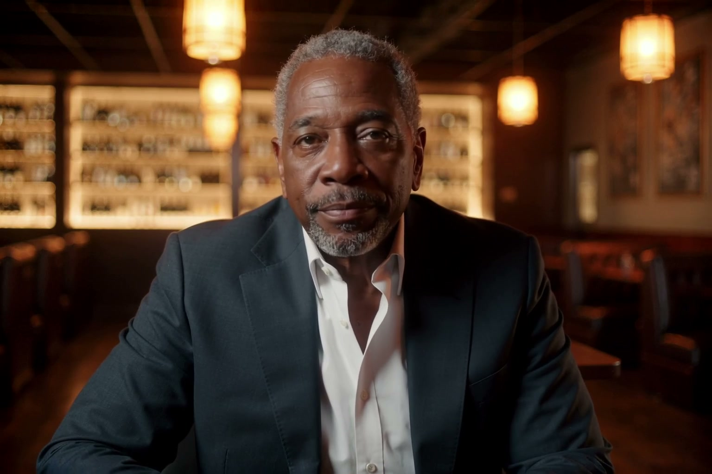
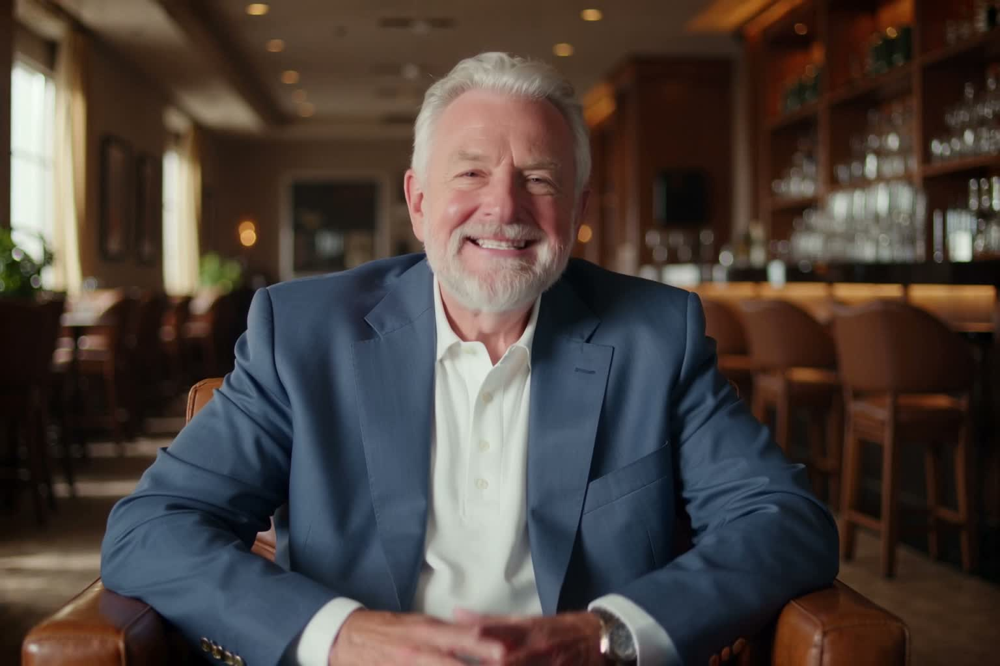

# Consistent Characters Registry (LTX-2.5)

This file is the canonical **character bible** for LTX-2.5 T2V/I2V/A2V workflows. Keeping each character's reference image, conditioning settings, identity/wardrobe block, voice/audio anchor, and tested seeds in one place ensures consistent look, lighting, and voice across Colab runs, RunPod/ComfyUI workflows, and ML training datasets.

---

## How to Promote a Generated Clip to a Consistent Character

1. Pick the best clip from a range test or T2V run.
2. Extract a crisp, neutral frame (usually frame 0 or a clean mid-clip frame) into `assets/<character_id>_ref.jpg`:
   ```bash
   ffmpeg -i runs/<run_id>/videos/<clip>.mp4 -vf "select=eq(n\,0)" -vframes 1 assets/<character_id>_ref.jpg
   ```
3. Copy the **New Character Template** at the bottom of this file and fill in its prompt blocks, conditioning strength, and seed.

---

## Character 01: `coach_prime` (Coach Prime) — Wine Bar Dating Coach (50s)

<a href="../assets/coach_ref.jpg"></a>

- **Status:** Active (formerly `coach_v1`; validated in `run_hq_20261114_160803`, `run_v3_20261114_174652`, and `run_v3_20261114_221513`)
- **Reference Image:** [coach_ref.jpg](file:///home/master/Software/content_maker/ttv_apps/assets/coach_ref.jpg) (`1536x1024`)
- **Pipeline & Checkpoint:** `ltx_pipelines.distilled` (`ltx-2.5-22b-distilled-transformer-bf16.safetensors`, 8-step)
- **Image Conditioning:**
  - Recommended: `--image /content/coach_ref.jpg 0 0.75 guide` (guide mode — faster, steadier, starts speaking cleanly on frame 1)
  - Alternative: `--image /content/coach_ref.jpg 0 0.65` (replace mode)
- **Video Specs:** `1536x1024` (`3:2`), `24 fps`, `121`–`241` frames (`5s`–`10s`)
- **Tested Seeds:** `401` (`run_hq`), `501`–`506` (`v3`), `1203674043` / random (`run_v3_20261114_174652`, `run_v3_20261114_221513`)

<br clear="both" />

### Identity, Environment & Motion Prompt Block (`CONSISTENT_SCENE`)
```text
Medium chest-up talking-head shot of the exact same older Black male coach in his 50s from the starting frame, seated in the same empty, dimly lit upscale wine bar and classy lounge at night with warm amber pendant lights and backlit wine bottles—no other people in the background. Cinematic 35mm shallow depth of field, sharp skin texture, crisp eyes. Continuous natural breathing, gentle shoulder and weight shifts, and smooth transitions between sentences without freezing. He maintains calm, steady eye contact with the camera, speaking with a smooth, composed, confident delivery, natural blinking, calm measured jaw movement, relaxed mouth, and subtle hand gestures.
```

### Voice & Audio Anchor Block (`AUDIO_STYLE`)
```text
Deep, warm, calm baritone voice captured on an off-camera boom mic, no visible microphone, clean studio-grade speech, minimal quiet lounge room tone, no background music, no crowd noise.
```

### Guardrails & Drift Notes
- Always include `"no other people in the background"` and `"no visible microphone"` so the model does not hallucinate bar patrons or a podcast mic.
- Keep `"Continuous natural breathing, gentle shoulder and weight shifts"` in the prompt when using `--image` conditioning to prevent static-torso lock.

---

## Character 02: `coach_warren` (Coach Warren) — Golf Clubhouse Dating Coach (60s)

<a href="../assets/coach_warren_ref.jpg"></a>

- **Status:** Active (promoted from `short_01_no_pain_no_gain_seed1596135219` in `run_v3_20261114_221513`)
- **Reference Image:** [coach_warren_ref.jpg](file:///home/master/Software/content_maker/ttv_apps/assets/coach_warren_ref.jpg) (`1536x1024`)
- **Pipeline & Checkpoint:** `ltx_pipelines.distilled` (`ltx-2.5-22b-distilled-transformer-bf16.safetensors`, 8-step)
- **Image Conditioning:**
  - Landscape (`3:2`): `--image /content/coach_warren_ref.jpg 0 0.75 guide`
  - Vertical (`9:16`): Center-crop `coach_warren_ref.jpg` to `9:16` before passing `--image /content/coach_warren_ref_9x16.jpg 0 0.75 guide`
- **Video Specs:** `1536x1024` (`3:2`) or `896x1536` (`9:16`), `24 fps`, `169`–`241` frames (`7s`–`10s`)
- **Origin Seed:** `1596135219` (`run_v3_20261114_221513`)

<br clear="both" />

### Identity, Environment & Motion Prompt Block
```text
Close-up portrait of a handsome, distinguished 60s white man with silver hair and a neatly groomed silver beard, sitting in a leather armchair inside an upscale, modern golf clubhouse lounge. He is dressed in smart-casual golf attire: a crisp white pique polo shirt layered under a tailored slate-blue lightweight performance blazer. He leans slightly forward with hands clasped, projecting warmth, high social intelligence, and magnetic authority—the quintessential modern dating coach. Soft directional window light illuminating one side of his face, rich warm wood and blurred bar glassware in the background, no other people in the background, shot on 85mm lens, f/1.4, Kodak Portra 400 film grain aesthetic, hyper-realistic, sharp focus on the eyes. He begins speaking smoothly on frame 1 with calm, father-figure warmth, natural blinking, relaxed mouth, and subtle composed gestures.
```

### Voice & Audio Anchor Block
```text
Deep, warm, calm, reassuring baritone voice captured on an off-camera boom mic, no visible microphone, clean studio-grade speech, quiet upscale clubhouse room tone, no background music, no crowd noise.
```

### Guardrails & Drift Notes
- Always include `"no other people in the background"` and `"no visible microphone"`.
- Keep dialogue to ~12–20 words per `193`–`241` frame clip (`8s`–`10s`) for a calm, unhurried cadence.

---

## Candidate Characters (Range Test — Pending Promotion)

Once `ltx25_coach_v4_lora_colab.ipynb` finishes, any standout 40s character below can be promoted by extracting a reference frame to `assets/` and filling in a full section:

| Candidate ID | Look / Wardrobe | Age | Setting |
| :--- | :--- | :--- | :--- |
| `range_01_turtleneck` | Short black hair (subtle gray temples), trimmed goatee, dark navy blazer over black turtleneck | Mid-40s | Upscale lounge, warm amber sconces, dark wood paneling |
| `range_02_glasses` | Clean-shaven head, thin-rimmed glasses, short black beard, tailored charcoal suit over open-collar white shirt | Early 40s | Classy wine bar at night, backlit bottles |
| `range_03_sportcoat` | Neat fade, full short beard, dark brown sport coat over burgundy knit polo | Late 40s | Upscale cocktail lounge at night, warm pendant lights |

---

## Template: Adding a New Character

```markdown
## Character XX: `<character_id>` — <Short Role / Title>

- **Status:** Draft / Active
- **Reference Image:** `assets/<character_id>_ref.jpg` (`<width>x<height>`)
- **Pipeline & Checkpoint:** `ltx_pipelines.distilled` (`ltx-2.5-22b-distilled-transformer-bf16.safetensors`)
- **Image Conditioning:** `--image /content/<character_id>_ref.jpg 0 <0.65_or_0.75_guide>`
- **Video Specs:** `1536x1024`, `24 fps`, `121`–`241` frames
- **Origin Seed / Run:** `<seed>` from `<run_id>`

### Identity, Environment & Motion Prompt Block
\`\`\`text
<Framing + age/ethnicity/hair/facial hair/wardrobe + exact lighting/background + camera/lens + breathing/micro-motion/delivery cues>
\`\`\`

### Voice & Audio Anchor Block
\`\`\`text
<Vocal timbre/pace/tone + mic placement ("off-camera boom mic, no visible microphone") + room tone + exclusions ("no background music, no crowd noise")>
\`\`\`

### Guardrails & Drift Notes
- <Any artifacts to watch for or conditioning strength tweaks>
```
